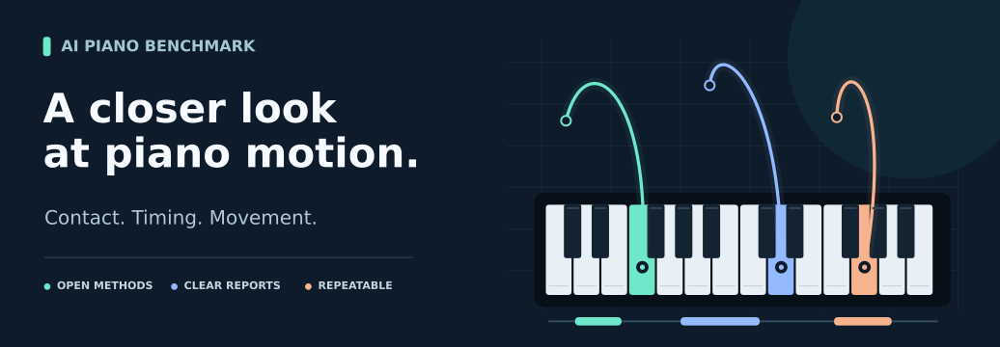
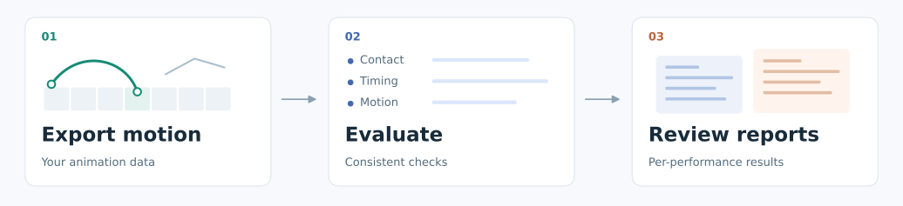

# AI Piano Animation Generator Benchmark



A lightweight toolkit for evaluating piano performance animation.
Compare motion, check key contact, and review results in one consistent workflow.

[Documentation](docs/PROTOCOL.md) · [Download](https://github.com/475519905/AI_Piano_Animation_Generator_benchmark/releases) · [MIT License](LICENSE)

## What it covers

- Fingering and key contact
- Motion and timing
- Pose comparison
- Per-performance reports



## Get started

Requires Python 3.9+.

```sh
git clone https://github.com/475519905/AI_Piano_Animation_Generator_benchmark.git
cd AI_Piano_Animation_Generator_benchmark
python -m pip install -e .
python examples/generate_synthetic.py .demo
```

[Run an evaluation](docs/DATA_SPEC.md) · [Explore the metrics](docs/METRICS.md) · [Connect your animation workflow](docs/ADAPTER_CHECKLIST.md)
